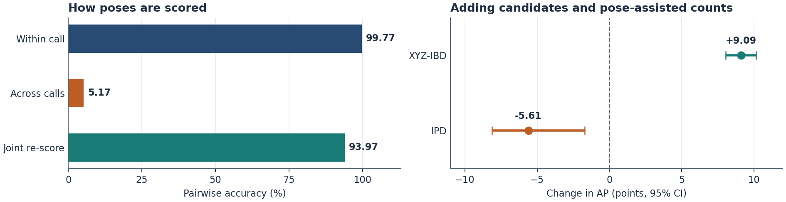
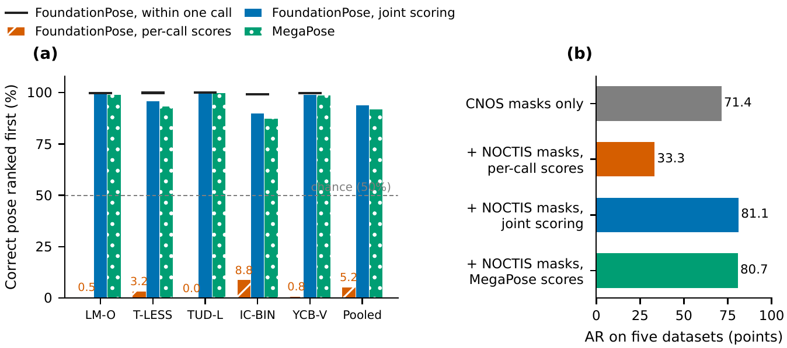
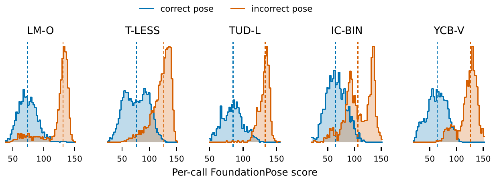
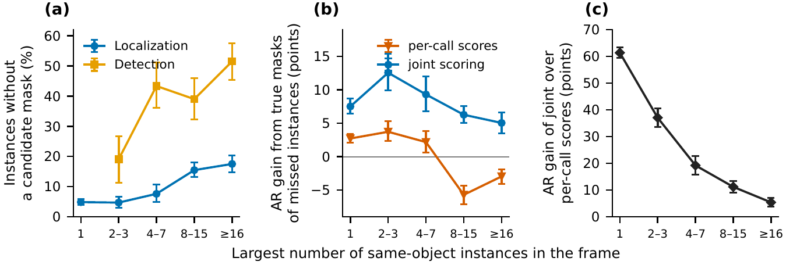
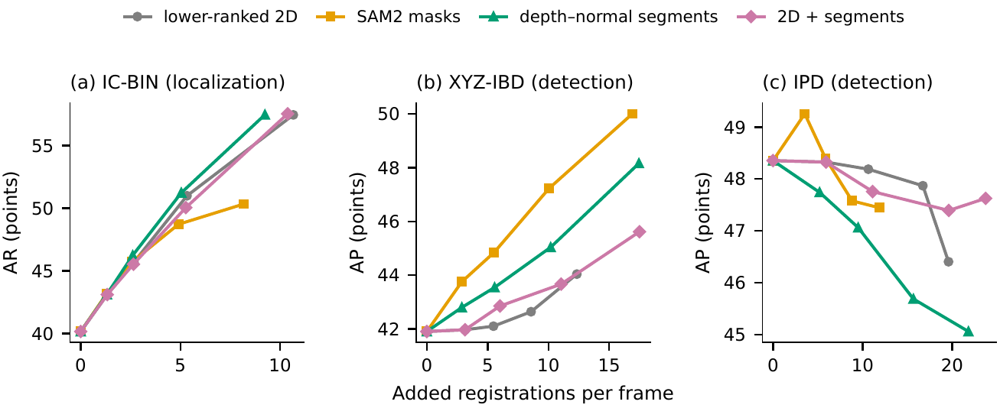
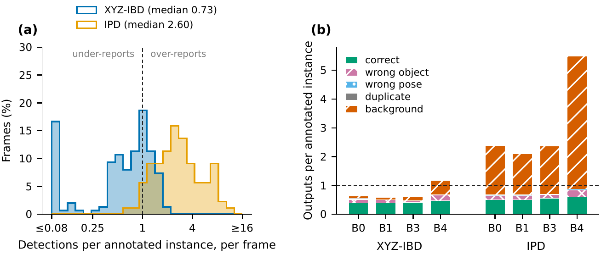

# Compare Before You Combine

**Cross-Call Rank Inversion in Unseen-Object 6D Pose Estimation**

[](https://github.com/CrianeZRX/compare-before-you-combine/actions/workflows/test.yml)
[](LICENSE)

[Project page](https://crianezrx.github.io/compare-before-you-combine/) · Paper (under review) · [Artifact guide](docs/ARTIFACT.md)

This project accompanies a study of how RGB-D pose pipelines combine candidate masks, compare pose scores, and decide how many instances to output. It provides CPU diagnostics for cached pose hypotheses and a compact, machine-readable snapshot of the paper's reported results.



## Findings

- On 36,852 pairs of best poses from different calls, FoundationPose per-call scores ranked the correct pose first **5.17%** of the time. Joint scoring of the same poses raised this to **93.97%**. Within a call, the per-call score achieved **99.77%** over 3,232,134 pairs.
- The average BOP AR across five classic datasets rose from **33.27** to **81.09** points when the same pool of best poses was scored jointly per object and image.
- Supplementary candidates with pose-assisted counting changed AP by **+9.09 points** on XYZ-IBD and **−5.61 points** on IPD compared with the standard per-mask pipeline. These results use the validation splits.

## Results at a glance

All plots below are regenerated from the files in [`paper/`](paper/README.md) by `paper/scripts/make_figures_v3.py`.

**Cross-call rank inversion.** (a) Share of correct–incorrect best-pose pairs (two masks, one target) ranked correctly; black marks: within one call. (b) BOP AR of CNOS masks alone and with NOCTIS masks under three rankings.



**Why per-call scores mislead.** Per-call FoundationPose scores of the best pose of each mask, for correct and incorrect poses (dashed lines: medians). Incorrect poses score higher on all five datasets, so ranking across calls by these scores selects them.



**Missed instances grow with density.** (a) Share of instances that no candidate mask overlaps. (b) Gain from their ground-truth masks under per-call or joint scoring (joint: post hoc). (c) Joint minus per-call. Bars: 95% intervals.



**Candidate budget.** Accuracy against the number of added registrations per frame, for four candidate sources and 0, 1, 2, 4 or 8 added candidates per object, under joint scoring.



**When to count from verified poses.** (a) Detections per annotated instance, per frame. (b) Output poses per annotated instance, by class. On IPD, where the detector over-reports, the pose-assisted count (B4) mainly adds poses on the background.



## Quick start

Python 3.10 or later. The diagnostics and aggregate replay run on CPU with the Python standard library.

```bash
python -m pip install .
compare6d audit examples/synthetic_calls.json
compare6d replay data/paper_results.json --out build/results
```

The first command after installation audits a synthetic target. Its per-call scores place the incorrect pose first. Its joint scores place the correct pose first. The replay writes CSVs for ranking, pairwise accuracy, counting, candidate coverage, and the supplementary SAM 3 gate, plus a short Markdown summary.

## Use your own cached poses

- `compare6d audit` compares per-call, relative, and joint scores. See the [input schema](docs/INPUTS.md) for correctness labels, grouping, and tie conventions.
- `compare6d.ranking.score_jointly` accepts a scorer callback and re-scores one fixed winner from each mask in a single call for an image–object target.
- `compare6d.selection.select_detections` applies the B0–B4 output rules to registered candidates, with translation NMS and the paper's output caps.

## Results and scope

The [artifact guide](docs/ARTIFACT.md) maps the code and data to the experiments. The [aggregate snapshot](data/paper_results.json) comes from the archived paper evaluations. Replaying it checks arithmetic and regenerates result tables. Computing fresh BOP metrics requires predictions, the benchmark datasets, and the official evaluator. The [`paper/`](paper/README.md) folder holds the result files of the controlled study and the scripts that regenerate the controlled study's tables and figures and recompute the numbers quoted in the manuscript text. Model weights, RGB-D frames and CAD meshes are not redistributed; obtain them from their original sources.

## Citation

Cite the manuscript as *Compare Before You Combine: Cross-Call Rank Inversion in Unseen-Object 6D Pose Estimation*.

## License

The code and the result files in this repository are released under the [MIT License](LICENSE). Benchmark data, models and detectors used in the study are not included and remain under their own licenses.
